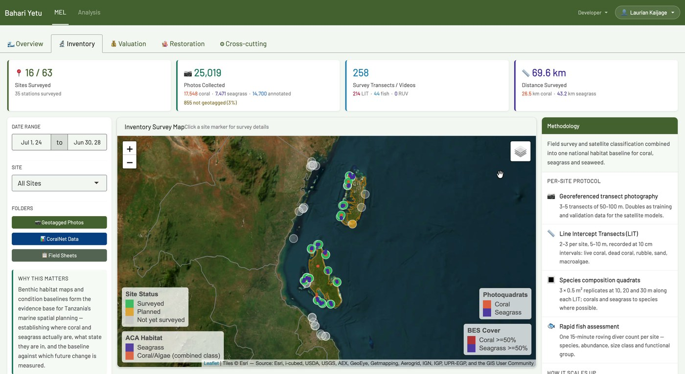

```{=html}
<div class="page-hero">
  <p class="hero-tagline">Built in R — turning field data into decisions</p>
</div>
```

::: {.project-grid}

::: {.card}
### Bahari Yetu Reporting Tool

{.app-screenshot}

**The project:** Pamoja Tuhifadhi Bahari Yetu is an EU-funded programme implemented by The Nature Conservancy in Tanzania, covering marine ecosystem inventory, valuation and coral reef restoration.

**Data collected:** benthic cover, reef fish, invertebrates, coral recruits, threats and georeferenced seabed photographs.

**What the tool helps with:** tracking survey progress, mapping survey coverage, checking data quality and analysing the results in one place.
:::

:::
