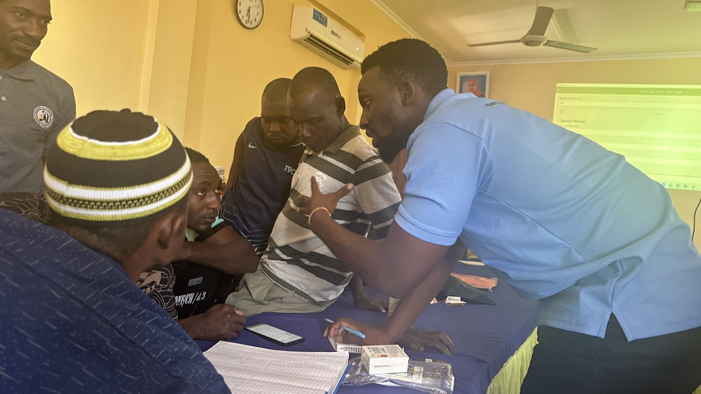
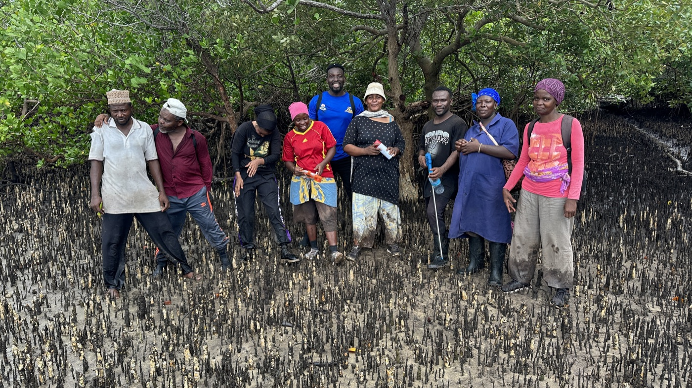
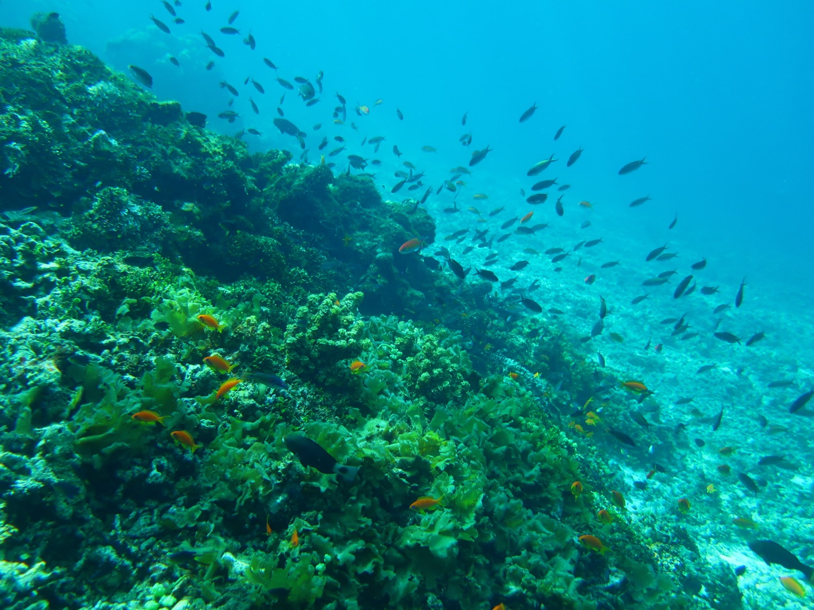
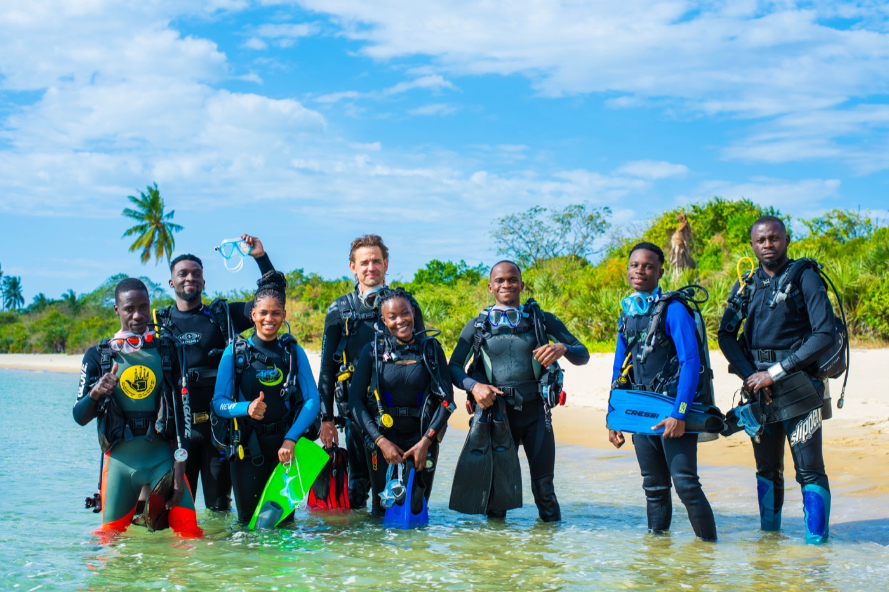
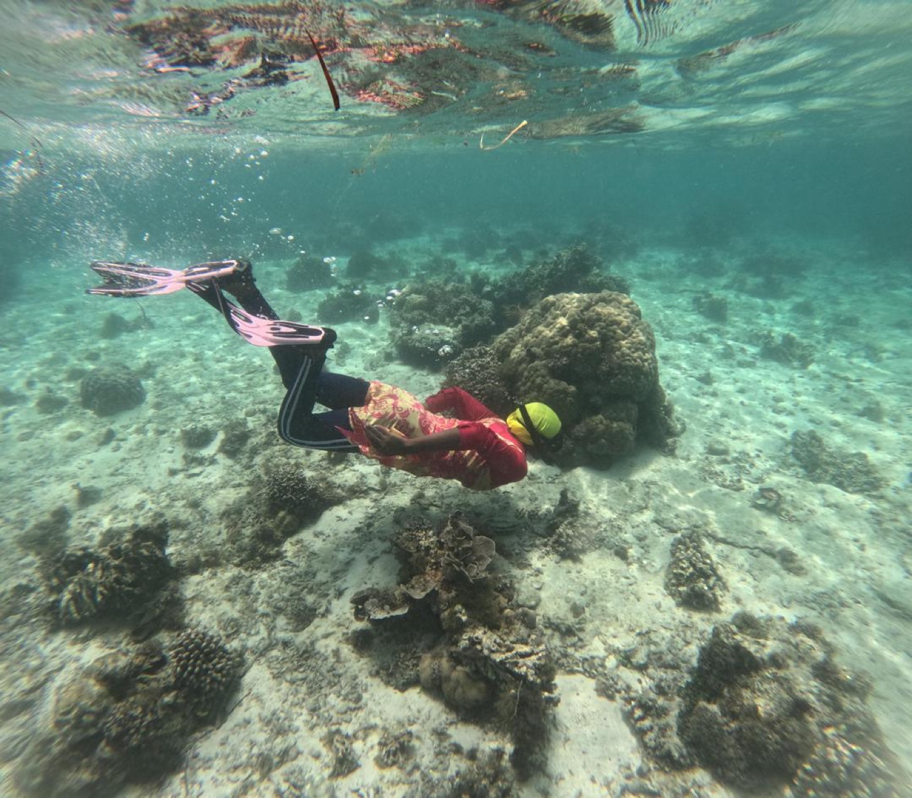
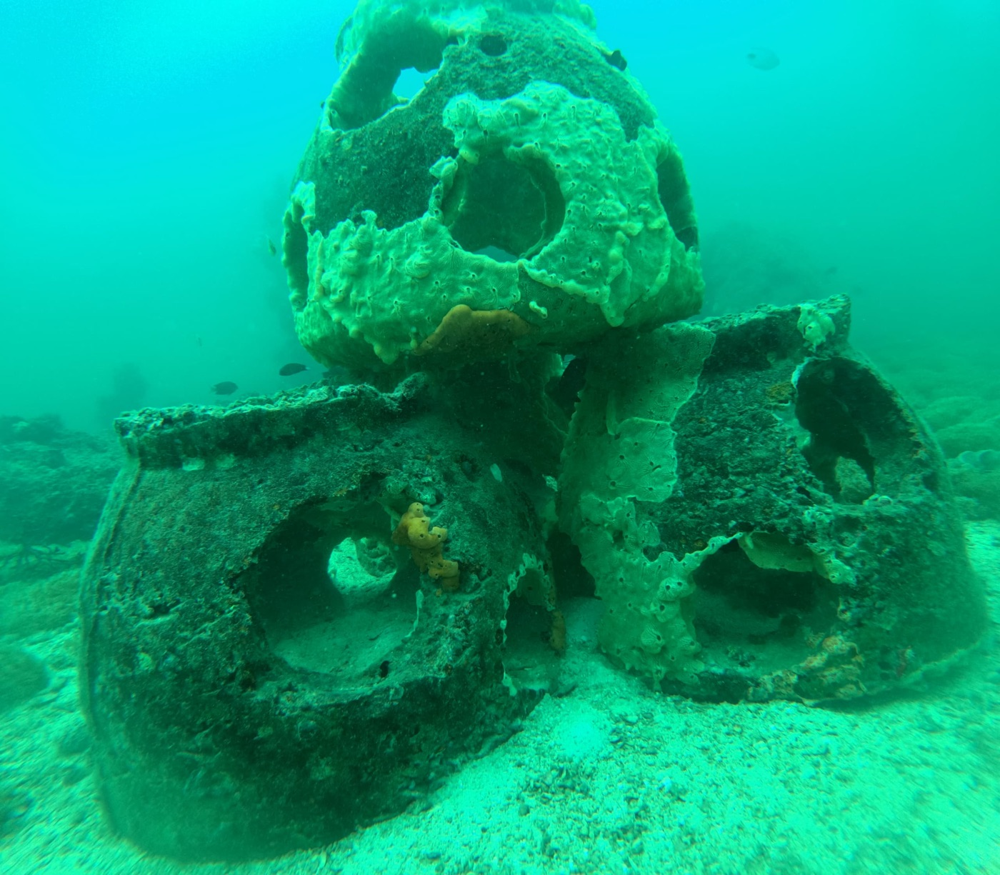
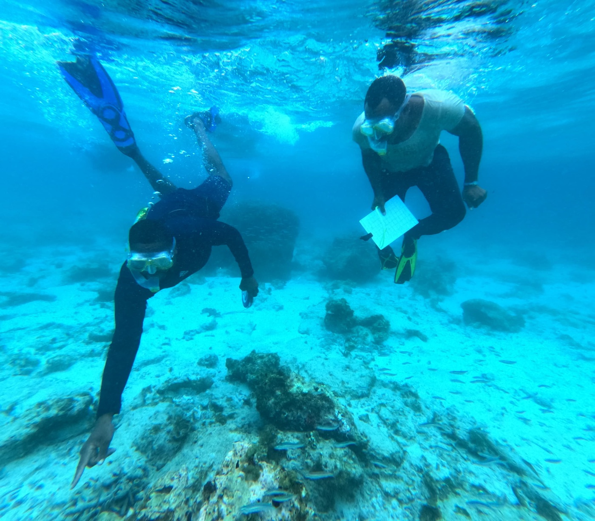

```{=html}
<div class="page-hero">
  <p class="hero-tagline">From the reef to the community — real outcomes on the Swahili Coast</p>
</div>
```

## Work on the Ground

My conservation work spans 50 communities across Zanzibar and the Tanga region of Northern Tanzania. Every protocol I design, every dataset I analyse, and every person I train is part of a connected effort to put ecological evidence at the centre of coastal management decisions.

---

## Key Impact Areas

::: {.impact-grid}

::: {.impact-area-card}
### 👥 Community Training — Fisheries Data Collection

Trained **200 community members** across **50 communities** (Zanzibar and Tanga region) on fisheries data collection protocols covering **reef fish, prawns, and octopus**. Training equipped local fishers with the skills to systematically record catch and effort data, turning everyday fishing activity into a conservation monitoring tool.

**Outcomes:**
- 200 trained community monitors actively collecting fisheries data
- 50 communities covered across Zanzibar and Northern Tanzania
- Community-generated data fed directly into **local management plans and adaptive management decisions**
- Increased local ownership of fisheries resource management
:::

::: {.impact-area-card}
### 🤿 In-Water Monitoring — Coral Reef Visual Census

Trained **300+ in-water monitors** in underwater visual census (UVC) techniques for coral reef monitoring, including data collection and analysis. A landmark achievement: **70 of these monitors are women** — breaking a significant cultural barrier in coastal Tanzania, where women's participation in snorkelling and underwater activities is highly unconventional.

**Outcomes:**
- 300+ trained underwater visual census monitors
- **70 women trained** as in-water monitors — unprecedented in this region
- Training extended beyond data collection to include **analysis of survey data**
- Results used to guide and support **coral reef restoration efforts**
:::

::: {.impact-area-card}
### 🪸 Coral Reef Restored Area

Provided data analysis and monitoring support for the restoration of **347 hectares of coral reef restored area**, including the deployment of **1,300 artificial reef structures**. This work involved designing data collection protocols, coordinating field surveys, and analysing reef health data to track restoration progress.

**Outcomes:**
- 347 ha of coral reef area restored and monitored
- 1,300 artificial reef structures deployed and tracked
- Reef health data used to measure restoration effectiveness
- Monitoring protocols adapted for long-term community fish replenishment zone management
:::

::: {.impact-area-card}
### 🌿 Mangrove Restoration & Seagrass Monitoring

Supported the restoration of approximately **60 hectares of mangrove habitat** through data collection protocol design and analysis. Also led seagrass monitoring surveys contributing to understanding of coastal habitat connectivity and ecosystem health.

**Outcomes:**
- 60 ha of mangrove area supported through data-driven restoration
- Seagrass monitoring integrated into multi-habitat coastal assessment
- Restoration progress tracked with standardised protocols
- Data informing coastal ecosystem management decisions
:::

::: {.impact-area-card}
### 📋 Protocols & Survey Tools

Developed **Mwambao's second fish catch monitoring data protocol** — a landmark institutional tool that standardises fisheries data collection across the organisation's entire network. Created **10+ ecological survey forms** covering all major survey types used by the ecological department.

**Outcomes:**
- New fish catch monitoring protocol in active use across the network
- 10+ survey forms designed for reef fish, coral, seagrass, mangrove, and octopus monitoring
- Standardised data collection reducing errors and improving comparability
- Institutional data quality significantly improved
:::

::: {.impact-area-card}
### 📊 Ecological Data Analysis

Led **all ecological data analysis** for Mwambao's ecological department — spanning fisheries, mangrove restoration, seagrass monitoring, and coral reef monitoring. Transforming raw field data from across the network into findings that drive conservation planning and adaptive management.

**Outcomes:**
- End-to-end analysis across four ecosystem monitoring programmes
- Annual reports and internal dashboards produced for each programme
- Data-driven adaptive management recommendations delivered to teams
- Analytical pipelines built in R for reproducible, efficient reporting
:::

:::

---

## Field Photos

```{=html}
<style>
.fc-wrap {
  position: relative;
  width: 100%;
  max-width: 900px;
  margin: 1.5rem auto;
  border-radius: 12px;
  overflow: hidden;
  box-shadow: 0 6px 28px rgba(0,0,0,0.22);
  background: #000;
  touch-action: pan-y;
}
.fc-track {
  display: flex;
  transition: transform 0.42s cubic-bezier(0.4,0,0.2,1);
  will-change: transform;
}
.fc-slide {
  min-width: 100%;
  position: relative;
  cursor: pointer;
}
.fc-slide img {
  width: 100%;
  height: clamp(260px, 42vw, 480px);
  object-fit: cover;
  display: block;
  pointer-events: none;
}
/* Hint bar */
.fc-hint {
  position: absolute;
  bottom: 36px; left: 0; right: 0;
  text-align: center;
  font-size: 0.72rem;
  letter-spacing: 0.04em;
  color: rgba(255,255,255,0.65);
  pointer-events: none;
  transition: opacity 0.3s;
  z-index: 6;
}
/* Caption overlay slides up */
.fc-caption {
  position: absolute;
  bottom: 0; left: 0; right: 0;
  background: linear-gradient(transparent, rgba(0,0,0,0.88) 35%);
  color: #fff;
  padding: 3rem 1.5rem 1.1rem;
  transform: translateY(100%);
  transition: transform 0.36s ease;
  z-index: 8;
}
.fc-caption.open { transform: translateY(0); }
.fc-caption p { margin: 0; font-size: 0.87rem; line-height: 1.55; }
.fc-caption-close {
  position: absolute;
  top: 0.5rem; right: 0.8rem;
  background: none; border: none;
  color: rgba(255,255,255,0.75);
  font-size: 1.1rem;
  cursor: pointer;
  padding: 0.2rem 0.4rem;
  line-height: 1;
}
.fc-caption-close:hover { color: #fff; }
/* Arrows */
.fc-arrow {
  position: absolute;
  top: 50%; transform: translateY(-50%);
  width: 40px; height: 40px;
  border-radius: 50%;
  background: rgba(0,0,0,0.42);
  border: 1px solid rgba(255,255,255,0.18);
  color: #fff;
  font-size: 1.5rem;
  cursor: pointer;
  display: flex; align-items: center; justify-content: center;
  z-index: 10;
  transition: background 0.2s;
  padding: 0; line-height: 1;
}
.fc-arrow:hover { background: rgba(0,0,0,0.78); }
.fc-arrow.prev { left: 12px; }
.fc-arrow.next { right: 12px; }
/* Dots */
.fc-dots {
  position: absolute;
  bottom: 10px; left: 0; right: 0;
  display: flex; justify-content: center; gap: 7px;
  z-index: 10;
}
.fc-dot {
  width: 7px; height: 7px;
  border-radius: 50%;
  border: none;
  background: rgba(255,255,255,0.38);
  cursor: pointer;
  padding: 0;
  transition: background 0.25s, transform 0.25s;
}
.fc-dot.on { background: #fff; transform: scale(1.35); }
/* Counter badge */
.fc-counter {
  position: absolute;
  top: 10px; right: 12px;
  background: rgba(0,0,0,0.45);
  color: rgba(255,255,255,0.8);
  font-size: 0.72rem;
  padding: 0.18rem 0.55rem;
  border-radius: 20px;
  z-index: 10;
  pointer-events: none;
}
</style>

<div class="fc-wrap" id="fcWrap">
  <div class="fc-track" id="fcTrack">

    <div class="fc-slide"
         data-caption="Fisheries data collection training — teaching community monitors to record reef fish, prawn and octopus catch data. Part of a programme reaching 200 monitors across 50 communities in Zanzibar and the Tanga region.">
      
    </div>

    <div class="fc-slide"
         data-caption="Field team in a mangrove restoration site — supporting 60 ha of habitat recovery through data-driven monitoring and standardised survey protocols designed for community-led implementation.">
      
    </div>

    <div class="fc-slide"
         data-caption="A healthy reef ecosystem — the kind of biodiversity our monitoring programmes track and protect across Tanzania's Swahili Coast, from reef fish census to coral health assessments.">
      
    </div>

    <div class="fc-slide"
         data-caption="Tanzania DiveLab participants — AFO's Ocean Access Program creating equitable access to the ocean for marine scientists and conservation practitioners from underrepresented communities.">
      
    </div>

    <div class="fc-slide"
         data-caption="One of 70 women trained as in-water monitors — conducting a reef survey, breaking significant cultural barriers in coastal Tanzania where women's participation in snorkelling and underwater activities is highly unconventional.">
      
    </div>

    <div class="fc-slide"
         data-caption="Artificial reef structures deployed on the seabed — coral colonisation already visible on the structures. Part of 1,300 units deployed across 347 ha of restored reef area along Tanzania's coast.">
      
    </div>

    <div class="fc-slide"
         data-caption="Trained community in-water monitors conducting underwater visual census — recording reef fish species, abundance and size on waterproof datasheets. Over 300 monitors trained across Zanzibar and Northern Tanzania.">
      
    </div>

  </div>

  <button class="fc-arrow prev" id="fcPrev" aria-label="Previous photo">&#8249;</button>
  <button class="fc-arrow next" id="fcNext" aria-label="Next photo">&#8250;</button>

  <div class="fc-hint" id="fcHint">Click photo for context</div>

  <div class="fc-caption" id="fcCaption">
    <button class="fc-caption-close" id="fcClose" aria-label="Close caption">✕</button>
    <p id="fcCaptionText"></p>
  </div>

  <div class="fc-counter" id="fcCounter">1 / 7</div>
  <div class="fc-dots" id="fcDots"></div>
</div>

<script>
(function () {
  const wrap    = document.getElementById('fcWrap');
  const track   = document.getElementById('fcTrack');
  const hint    = document.getElementById('fcHint');
  const caption = document.getElementById('fcCaption');
  const capText = document.getElementById('fcCaptionText');
  const counter = document.getElementById('fcCounter');
  const dotsRow = document.getElementById('fcDots');
  const slides  = Array.from(wrap.querySelectorAll('.fc-slide'));
  const total   = slides.length;
  let cur = 0, captionOpen = false, timer, startX = 0;

  // Build dots
  slides.forEach(function (_, i) {
    var d = document.createElement('button');
    d.className = 'fc-dot' + (i === 0 ? ' on' : '');
    d.setAttribute('aria-label', 'Go to photo ' + (i + 1));
    d.addEventListener('click', function (e) { e.stopPropagation(); goTo(i); });
    dotsRow.appendChild(d);
  });

  function goTo(n) {
    cur = ((n % total) + total) % total;
    track.style.transform = 'translateX(-' + (cur * 100) + '%)';
    counter.textContent = (cur + 1) + ' / ' + total;
    dotsRow.querySelectorAll('.fc-dot').forEach(function (d, i) {
      d.classList.toggle('on', i === cur);
    });
    closeCaption();
    resetTimer();
  }

  function openCaption() {
    capText.textContent = slides[cur].dataset.caption;
    caption.classList.add('open');
    hint.style.opacity = '0';
    captionOpen = true;
  }

  function closeCaption() {
    caption.classList.remove('open');
    hint.style.opacity = '1';
    captionOpen = false;
  }

  // Click slide to toggle caption
  slides.forEach(function (s) {
    s.addEventListener('click', function (e) {
      if (e.target.closest('.fc-arrow') || e.target.closest('.fc-caption-close')) return;
      captionOpen ? closeCaption() : openCaption();
    });
  });

  document.getElementById('fcPrev').addEventListener('click', function (e) { e.stopPropagation(); goTo(cur - 1); });
  document.getElementById('fcNext').addEventListener('click', function (e) { e.stopPropagation(); goTo(cur + 1); });
  document.getElementById('fcClose').addEventListener('click', function (e) { e.stopPropagation(); closeCaption(); });

  // Swipe
  wrap.addEventListener('touchstart', function (e) { startX = e.touches[0].clientX; }, { passive: true });
  wrap.addEventListener('touchend', function (e) {
    var diff = startX - e.changedTouches[0].clientX;
    if (Math.abs(diff) > 40) goTo(cur + (diff > 0 ? 1 : -1));
  });

  // Keyboard
  document.addEventListener('keydown', function (e) {
    if (!wrap.closest('body')) return;
    if (e.key === 'ArrowLeft')  goTo(cur - 1);
    if (e.key === 'ArrowRight') goTo(cur + 1);
    if (e.key === 'Escape')     closeCaption();
  });

  // Auto-advance, pause on hover
  function resetTimer() { clearInterval(timer); timer = setInterval(function () { goTo(cur + 1); }, 5000); }
  wrap.addEventListener('mouseenter', function () { clearInterval(timer); });
  wrap.addEventListener('mouseleave', resetTimer);

  goTo(0);
})();
</script>
```

---

## Professional Journey

*A timeline of roles, projects, and milestones across Tanzania's coastal conservation sector.*

```{=html}
<div class="timeline">

  <div class="timeline-item left">
    <div class="timeline-content">
      <span class="timeline-year">2021 – 2023</span>
      <h3>Research Assistant — BIOEEL-TZ, University of Dar es Salaam</h3>
      <p>Conducted fish biodiversity data collection and analysis, environmental parameter monitoring, and community capacity building workshops. Supported international conference reporting and co-produced a scientific documentary on anguillid eels in Tanzania as narrator and field researcher.</p>
    </div>
  </div>

  <div class="timeline-item right">
    <div class="timeline-content">
      <span class="timeline-year">2023 – 2026</span>
      <h3>Ecological Data Manager — Mwambao Coastal Community Network</h3>
      <p>Took on the full ecological data management role at Mwambao — designing monitoring protocols, leading community training across 50 communities, building data pipelines in R, and producing annual reports across fisheries, coral reef, mangrove, and seagrass programmes.</p>
    </div>
  </div>

  <div class="timeline-item left">
    <div class="timeline-content">
      <span class="timeline-year">2023 – 2024</span>
      <h3>Communications Manager — Sustainable Ocean Alliance Tanzania</h3>
      <p>Served as Communications Manager for SOA Tanzania — mobilising members, facilitating onboarding, bridging leadership and community members, and promoting active participation in ocean conservation programmes.</p>
    </div>
  </div>

  <div class="timeline-item right">
    <div class="timeline-content">
      <span class="timeline-year">2026 – Present</span>
      <h3>Marine Ecology Officer — The Nature Conservancy</h3>
      <p>Joined The Nature Conservancy as Marine Ecology Officer, leading fieldwork coordination, data collection protocols, and stakeholder engagement under the Pamoja Tuhifadhi Bahari Yetu project — working across Mtwara and Unguja North to strengthen marine co-management and biodiversity conservation.</p>
    </div>
  </div>

</div>
```

---

## By the Numbers

```{=html}
<div class="stats-grid">
  <div class="stat-box">
    <div class="stat-number">200</div>
    <div class="stat-desc">Community members trained in fisheries data collection</div>
  </div>
  <div class="stat-box">
    <div class="stat-number">50</div>
    <div class="stat-desc">Communities reached across Zanzibar & Tanga region</div>
  </div>
  <div class="stat-box">
    <div class="stat-number">300+</div>
    <div class="stat-desc">In-water monitors trained in underwater visual census</div>
  </div>
  <div class="stat-box">
    <div class="stat-number">70</div>
    <div class="stat-desc">Women trained as in-water monitors — breaking cultural barriers</div>
  </div>
  <div class="stat-box">
    <div class="stat-number">347 ha</div>
    <div class="stat-desc">Coral reef area restored and monitored</div>
  </div>
  <div class="stat-box">
    <div class="stat-number">1,300</div>
    <div class="stat-desc">Artificial reef structures deployed and tracked</div>
  </div>
  <div class="stat-box">
    <div class="stat-number">60 ha</div>
    <div class="stat-desc">Mangrove habitat supported through restoration data work</div>
  </div>
  <div class="stat-box">
    <div class="stat-number">10+</div>
    <div class="stat-desc">Ecological survey forms designed across all ecosystem types</div>
  </div>
</div>
```

---

## Partners & Collaborators

::: {.partners-row}
- **The Nature Conservancy** — current employer, Pamoja Tuhifadhi Bahari Yetu project
- **Mwambao Coastal Community Network** — ecological data management and community programmes
- **Sustainable Ocean Alliance Tanzania** — communications and member engagement
- **EU Commission Tanzania** — Youth Sounding Board advisory member
- **University of Dar es Salaam / BIOEEL-TZ** — research and documentary production
- **Coastal fishing communities** — Zanzibar and Tanga region (50 communities)
- **Local Government Authorities** — management plan integration and marine spatial planning
:::
